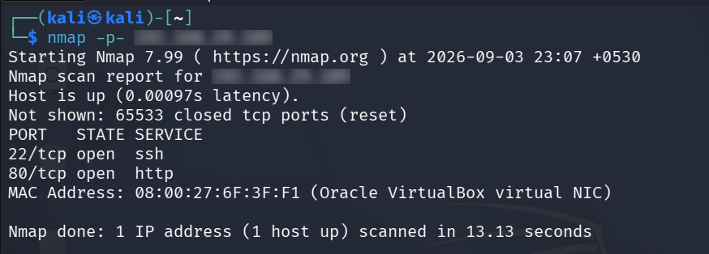
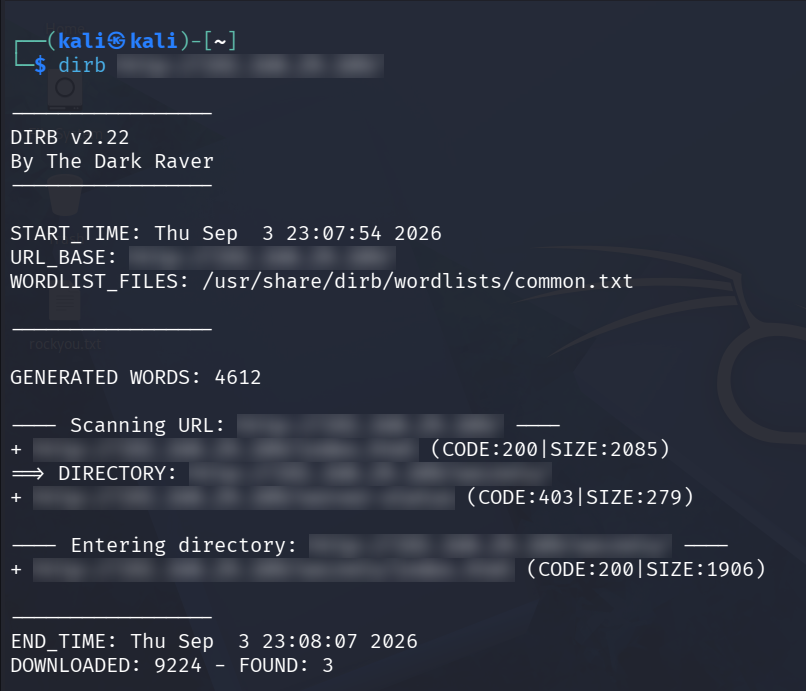
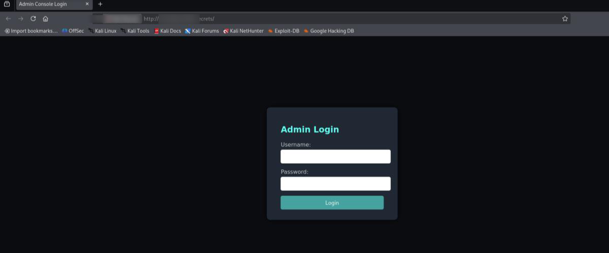
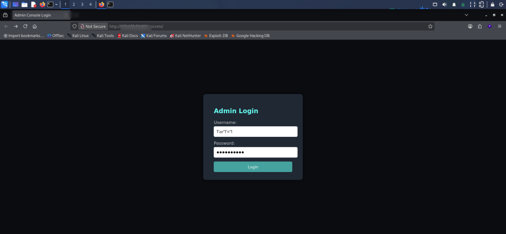
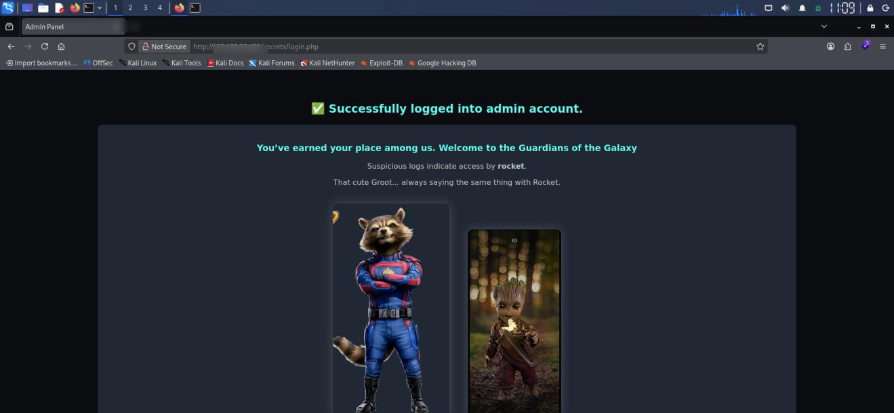
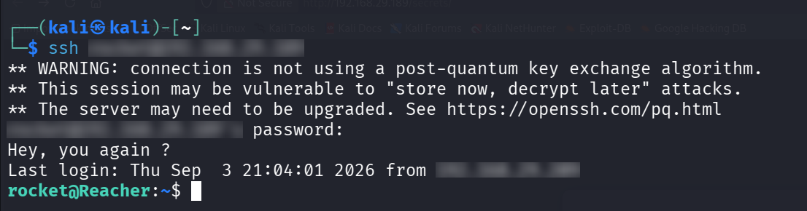
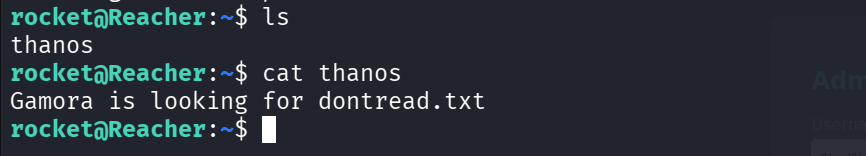
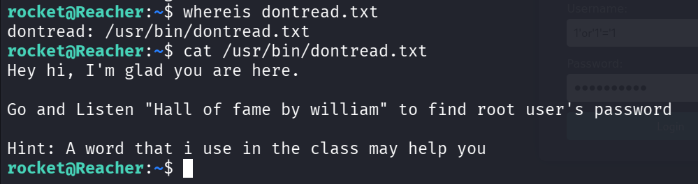
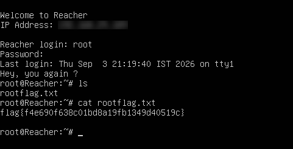

# SQL Injection Authentication Bypass — Reacher Machine

**Category:** Web / SQL Injection / Linux Privilege Escalation  
**Environment:** Authorized, isolated training-lab virtual machine (VirtualBox)  
**Target OS:** Linux (Reacher lab machine)  
**Status:** Completed — administrative, SSH user, and root access obtained

> Machine IP address, credential values, and flag values are redacted. This write-up describes the assessment method and evidence without publishing those values.

---

## Summary

This write-up documents an assessment of the Reacher machine in an isolated training-lab environment. The engagement involved service discovery, web directory enumeration, testing an administrative login for SQL injection, obtaining SSH access using information revealed by the application, and following local clues to achieve root-level access.

## Skills Demonstrated

- Network scanning and service identification with Nmap
- Web directory enumeration with DIRB
- Identifying and validating an SQL injection authentication bypass
- Reviewing application content for credential-related clues
- Establishing and verifying SSH access
- Linux post-login enumeration and clue analysis
- Privilege escalation assessment and root-access verification
- Vulnerability impact analysis and remediation reasoning

---

## 1. Reconnaissance — Service Discovery

An Nmap scan was run against the lab target to identify the host's exposed TCP services.

**Findings:**
- SSH was exposed on TCP port 22.
- HTTP was exposed on TCP port 80.
- The host was reachable during the scan.

## 2. Web Enumeration

The HTTP service was enumerated with DIRB. The scan identified the `/secrets/` directory, which returned HTTP 200 and was selected for further inspection.

## 3. Admin Login Discovery

Browsing to `/secrets/` displayed an Admin Login page containing username and password fields.

## 4. Exploitation — SQL Injection Authentication Bypass

The username field was tested with a SQL-injection-style input to determine whether user-controlled input was being handled safely by the application's authentication logic.

The application accepted the test input and displayed a successful administrative login message. The Admin Panel became accessible.

**Result:** Authentication bypass confirmed in the authorized lab environment.

## 5. Credential Clue and SSH Access

The Admin Panel displayed a clue involving Rocket and Groot. Following the clue identified credentials for the `rocket` account. The credential value is intentionally omitted from this public write-up.

The recovered account was used to establish an SSH session to the target. The shell prompt confirmed access as the `rocket` user.

**Result:** Authenticated SSH access and a low-privileged shell obtained.

## 6. First Server-Side Clue

The Rocket user's home directory contained a file named `thanos`. Its contents indicated that Gamora was looking for `dontread.txt`.

## 7. Second Server-Side Clue

The `dontread.txt` file was located under `/usr/bin/`. Its contents referred to **“Hall of fame by william”** and indicated that the clue could help identify the root user's password. The password value is omitted.

## 8. Root Access Verification

Following the supplied clue led to successful root login in the lab. The root shell and the presence of `rootflag.txt` confirmed root-level access. The flag value is redacted.

**Result:** Full root-level access obtained in the training environment.

---

## Impact

The demonstrated attack chain began with an SQL injection vulnerability in the web application's administrative login. Access to the Admin Panel exposed information that enabled further access to the host. The chain progressed to SSH access as the `rocket` user and ultimately to root-level access.

A comparable vulnerability chain in a production environment could result in complete compromise of the affected system, impacting the confidentiality, integrity, and availability of its data and services.

## Root Cause

- The administrative login trusted user-controlled input in a way that allowed authentication logic to be manipulated.
- Sensitive credential-related clues were exposed through application content.
- Information available after obtaining a low-privileged shell helped identify further access paths.
- The root account's credential was discoverable through clues on the host, indicating inadequate protection of privileged authentication information.

## Remediation Recommendations

| Issue | Recommendation |
|---|---|
| SQL injection in authentication | Use parameterized queries or prepared statements for all database operations involving user input. Never build authentication queries by concatenating raw input. |
| Weak authentication design | Apply secure authentication patterns, server-side validation, and secure password hashing. |
| Credential information exposed in the application | Remove credentials, password hints, and sensitive operational clues from web pages and application files. |
| Excessive impact from application compromise | Apply least-privilege permissions to web and service accounts. |
| SSH account exposure | Use strong, unique credentials or key-based authentication; restrict SSH access and monitor authentication attempts. |
| Insufficient monitoring | Log and alert on anomalous authentication activity, repeated failures, and unexpected administrative access. |

## Lessons Learned

- Enumerating web directories can reveal application areas that are not linked from the main page.
- Authentication forms should be tested for unsafe handling of user-controlled input during an authorized assessment.
- Information exposed in an application can create a path from a web vulnerability to operating-system access.
- Post-login file and directory review can reveal clues about the host's configuration and security posture.
- Privileged credentials and hints must not be stored in locations accessible to ordinary users.

---

*This assessment was carried out in an authorized, isolated training-lab environment. No production systems or third-party assets were involved.*

